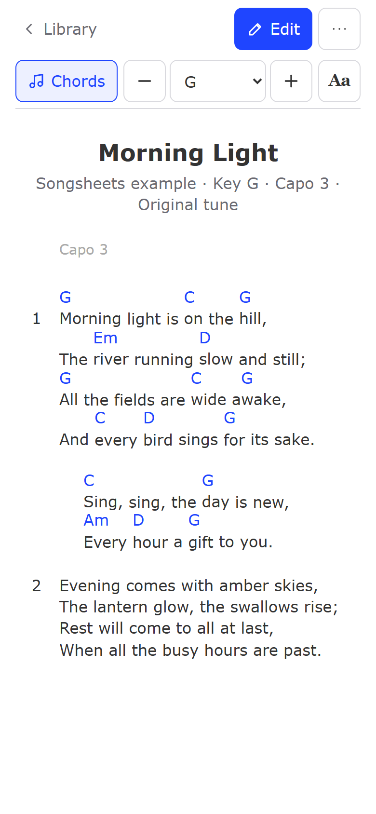
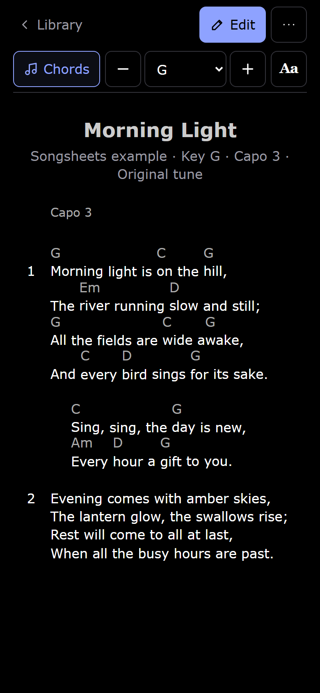
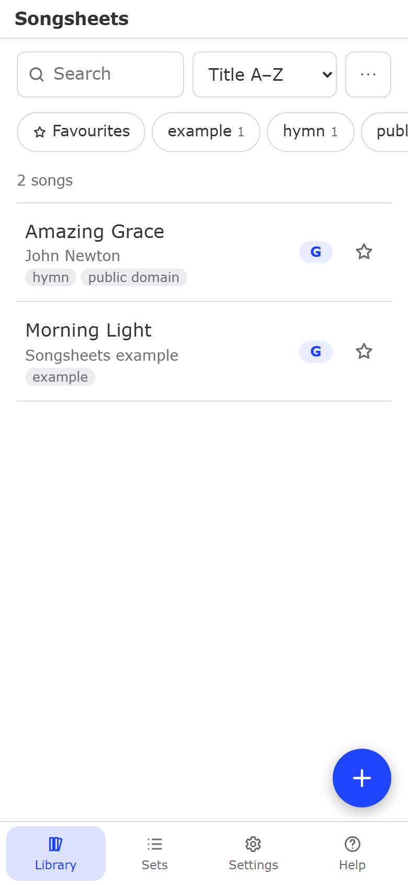
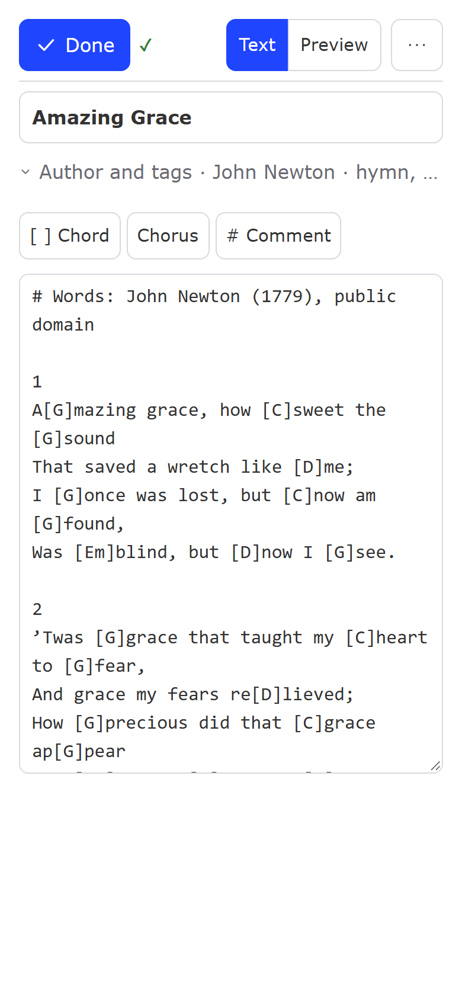
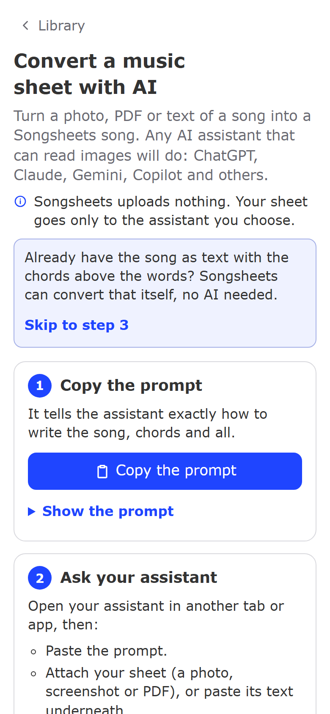

<div align="center">

# Songsheets

**Chord sheets you write once and play anywhere.**

Write songs in plain text, transpose them to any key, build set lists, and export them as
PDF, Word, ChordPro and more. Plain HTML, CSS and JavaScript: no server, no build step,
no account. Your songs stay in your browser.

[**Open the app**](https://rogerdewald.github.io/songsheets/) · [Write a song](#writing-a-song) · [Convert a sheet with AI](#convert-a-music-sheet-with-ai) · [Host your own](#host-your-own-copy)

[](https://github.com/RogerDewald/songsheets/blob/main/package.json)
[](LICENSE)
[](https://rogerdewald.github.io/songsheets/)


<br>

&nbsp;
&nbsp;
&nbsp;
&nbsp;


</div>

---

## Contents

- [Highlights](#highlights)
- [Get started](#get-started)
- [Writing a song](#writing-a-song)
- [Transposing](#transposing)
- [Set lists](#set-lists)
- [Convert a music sheet with AI](#convert-a-music-sheet-with-ai)
- [Exports and imports](#exports-and-imports)
- [Your data](#your-data)
- [How it differs from songbase](#how-it-differs-from-songbase)
- [Host your own copy](#host-your-own-copy)
- [Development](#development)
- [Credits and licence](#credits-and-licence)

## Highlights

| | |
|---|---|
| **Plain-text songs** | Put a chord in square brackets and it sits exactly above the next letter, even mid-word: `A[G]mazing grace`. Stanza numbers, chorus indents, comments, capo and alternative tunes are all plain text too. |
| **Transpose anything** | Move a song to any key with proper spelling (Ab, not G#), choose sharps or flats, show capo shapes, and the app remembers the key you chose for each song. |
| **Set lists** | Put songs in order, give each its own key and capo, swipe between them on stage, and export the whole set as one document with a contents page. |
| **Phone first** | Add it to your home screen and it opens like an app, works offline, keeps the screen on while a song is open, and uses a bottom tab bar sized for thumbs. |
| **Convert with AI** | Have a photo or PDF of a sheet? Copy a ready-made prompt, ask any assistant, paste the reply back. Songsheets checks it, shows a preview, and adds the song. |
| **Export everywhere** | Print or save as PDF, download a PDF or Word file, plain text, ChordPro, songbase text, a stand-alone web page, or a JSON backup of everything. |
| **Songbase compatible** | The format, chord placement and transposition tables come from [songbase](https://github.com/ReganRyanNZ/songbase). Text pastes between the two unchanged. |
| **Private by design** | Songs live in your browser's local storage. Nothing is uploaded, there is no account, and the app works from a single folder of files. |

## Get started

### Use it online

Open **<https://rogerdewald.github.io/songsheets/>**. That is the whole setup. After the first
visit it works offline.

### Install it on your phone

1. Open the address above once.
2. Add it to your home screen: **Share → Add to Home Screen** on iPhone, or
   **menu → Install app / Add to Home screen** on Android.
3. Open it from the home-screen icon from then on.

On a phone, the four main pages (Library, Sets, Settings, Help) sit on a tab bar at the bottom.
The **+** button adds a song, either by writing one or by copying the AI prompt. Import and backup
live in the **⋯** menu beside the search box. Pages you work inside (a song, the editor, a set, the
converter) use the whole screen.

> **iPhone users:** Safari can delete data from websites you have not opened for seven days. Apps on
> the home screen are exempt, so use Songsheets from the icon. The home-screen app has its own
> storage, separate from Safari. If you already have songs in Safari, download a backup there
> (**Settings → Download backup**) and import it in the app (**Library → ⋯ → Import files**).

### Run it on your computer

| How | What you get |
|---|---|
| Double-click `index.html` | Everything except offline caching, straight from the file |
| `python tools/serve.py` then open <http://localhost:8123/> | A local server with caching turned off, handy while editing the code |
| [Host your own copy](#host-your-own-copy) on GitHub Pages | Offline support and installable on phones and desktops, for free |

## Writing a song

```
# Lines starting with # are grey comments
# Capo 2

1
A[G]mazing grace, how [C]sweet the [G]sound
That saved a wretch like [D]me

  Chorus lines start
  with [F]two spaces
```

| You type | You get |
|---|---|
| `[G]word`, `ex[F]act` | A chord exactly above the next letter, even mid-word |
| Two leading spaces | A chorus line (indented) |
| `1` on its own line | The number of the stanza below it, hanging in the margin |
| `# text` | A comment |
| `# Capo 2` | A capo preset. Tap it to show the sounding chords (+2) |
| `# Key: Em` | Tells the transposer the key if it cannot guess it |
| `### Tune name` | Starts an alternative tune; the viewer gets a tune picker |
| `**bold**`, `*italic*`, `a_b` | Bold, italic, and a musical tie ‿ |
| `[F#m  Bm]`, `[N.C.]`, `[x2]` | Several chords at one spot; non-chords are never transposed |

**Editor shortcuts.** Typing `\` or `$` inserts `[]`. A lower-case a–g typed inside a bracket
becomes a capital, so `bb` gives `Bb`. Tab indents the selected lines as a chorus and Shift+Tab
removes the indent. The buttons stay put while you write, and author and tags fold away to leave
room for the text. All of this can be turned off in Settings.

**How chords are drawn.** Each chord is a zero-width marker placed exactly where its bracket was, so
the lyrics never move. Two chords closer together than their names are wide will overlap, so space
them by hand (`[F#m  Bm]`). Copying a sheet from the page gives lyrics only, because the chord
names are drawn by CSS.

## Transposing

Use **−** and **+** or the key picker. The chosen key, sharps-or-flats preference and tune are
remembered per song. Keys are spelled with songbase's scale tables, so a song in G moved up one
semitone reads Ab, Db, Eb rather than G#, C#, D#.

With a capo the sheet shows the chord shapes to play and the header says "Capo n". On a song, the
toolbar is one row (chords, key, More) that slides away while you scroll; **More** opens sharps or
flats, tune and text size. The screen stays on while a song is open, which Settings can turn off.

## Set lists

A set list is an ordered list of songs. Each song in a set can have its own key and capo without
changing the song itself. On a phone, swipe left or right to move between songs. Exporting a set
gives one document with each song on a new page and a contents page.

## Convert a music sheet with AI

Have a photo, PDF or screenshot of a song? **Help → Convert with AI** walks through three steps.
The Library also has a **Copy AI prompt** button (**+ → Copy the AI prompt** on a phone), and the
message it shows has a **Paste reply** button that jumps to step 3.

1. **Copy the prompt.** One button puts a ready-made prompt on the clipboard that tells an assistant
   exactly how to write a Songsheets song. It is also in the editor's **⋯** menu.
2. **Ask your assistant.** Paste the prompt into ChatGPT, Claude, Gemini or any assistant that can
   read images. Attach your sheet, or paste its text underneath.
3. **Paste the reply back.** Songsheets picks out the title, author, chords and words, tidies the
   usual slips, and shows a preview with a summary (lines, chords, key). Press **Add to library**.

Songsheets uploads nothing; the sheet goes only to the assistant you chose. Assistants can misplace
a chord or mishear a word, so look over the preview. The reader also copes with what assistants
often send instead of the exact format: a code block around the song, `[Chorus]` or `Verse 2`
labels, chords written above the words, or ChordPro. Everything it changed is listed under the
preview.

> **Already have text with the chords above the words**, the way chord websites show it? Skip the
> assistant. Paste it straight into step 3 and Songsheets converts it itself, exactly.

## Exports and imports

| Format | Notes |
|---|---|
| **Print / Save as PDF** | The browser's print dialog with a print stylesheet. Turn off the browser's own headers and footers |
| **PDF download** | Built in the browser with jsPDF. The built-in fonts cover Western European letters; for other scripts use Print → Save as PDF |
| **Word (.docx)** | Monospaced chord and lyric line pairs, so columns line up in Word, LibreOffice and Google Docs |
| **Plain text** | Chords on their own line above the lyrics, aligned by character |
| **ChordPro (.cho)** | Also imported, including files with chords written above the lyrics |
| **songbase text** | The raw format, transposed if you changed the key |
| **Web page (.html)** | One self-contained file with no scripts. Drop it back into the app to import it |
| **JSON backup** | All songs, set lists and settings. **Settings → Restore** can merge or replace |

Import accepts backups, exported web pages, ChordPro, text files, and songbase's API JSON
(`/api/v2/app_data`).

## Your data

- Songs, set lists and settings are kept in the browser's local storage on the device you use.
  Nothing leaves it.
- Songsheets asks the browser for persistent storage, and reminds you to download a backup when the
  last one is more than two weeks older than your changes.
- A JSON backup restores everything on any device. Download one from **Settings** and import it
  from **Library → ⋯ → Import files**.

## How it differs from songbase

Songsheets keeps songbase's format and output, and fixes a handful of things on purpose.

<details>
<summary>The ten deliberate differences</summary>

1. A capo preset is only recognised on a comment line, and also accepts `#Capo1` and `# Capo: 2`.
   Songbase turned any lyric containing "capo 3" into a button and lost the lyric.
2. `<`, `>` and backticks are allowed, because pages are built safely instead of from HTML strings.
3. Only real chord symbols are transposed. Songbase turned `[N.C.]` into `[N.Db.]` and `[Chorus]`
   into `[Dbhorus]`.
4. Transposing by 12 gives back the original chords. Key detection compares pitches, which fixes
   songs in F#m, C#m and F#, and `Cmaj7` is no longer read as minor.
5. A chord outside the key keeps the author's sharp or flat: a Bb in a song in G moved up 5 becomes
   Eb, not D#. Chords inside the key are spelled exactly as in songbase.
6. Bold, italic and ties only apply to lyric text, so they cannot break the markup.
7. `###` starts a tune only at the start of a line, and `####` is an ordinary comment.
8. Text and Word exports place chords by the lyric's characters. Songbase's print page drifted right
   after each chord.
9. The chosen key is remembered per song, and a `# Key:` comment can override detection.
10. Text is stored in Unicode NFC form (songbase stores NFD). Imports are converted.

</details>

## Host your own copy

The whole app is static files, so GitHub Pages hosts it for free.

```bash
git remote add origin https://github.com/<you>/songsheets.git
git push -u origin main
gh api -X POST repos/<you>/songsheets/pages -f "source[branch]=main" -f "source[path]=/"
```

The site appears at `https://<you>.github.io/songsheets/`. It uses `#/` addresses, so no server
rewrites are needed. After changing any file, run `node tools/bump-version.js` before pushing so
installed copies pick up the new version.

## Development

There is nothing to install. The tests and tools run on Node; the dev server is one Python file.

```bash
npm test                 # or: node --test
npm run serve            # python tools/serve.py, on http://localhost:8123/
```

| Tool | What it does |
|---|---|
| `node tools/bump-version.js` | Sets the version in `package.json`, `js/app/main.js` and the `sw.js` cache name. Run before every push |
| `node tools/sync-css.js` | Regenerates `js/export/cssStrings.js` after editing a stylesheet (the HTML export embeds the CSS) |
| `node tools/make-icons.js` | Redraws the icons in `icons/` |
| `node tools/screenshots.js` | Retakes the phone screenshots in `docs/` (start the dev server first; Node 22 or newer) |
| `node tools/smoke.js [url]` | End-to-end check in headless Chrome, against `file://` by default (Node 22 or newer) |
| `python tools/fix-escapes.py` | Turns invisible characters in sources into `\u` escapes. A test fails if any are left |

**Tests** cover the parser, the chord grammar, the songbase transposition vectors, rendering,
storage, import and every export format. The AI prompt is `PROMPT` in `js/app/aiConvert.js`; each
rule it states is pinned to what the real parser does, so if you change the song format the tests
name the sentence of the prompt that went out of date. The vendored libraries are hash-checked
against `vendor/README.md`.

**Adding a script:** list it in both `index.html` and the asset list in `sw.js`, or
`tests/app/shell.test.js` fails.

```
js/core      the engine, runs in Node too: parser, chords, transpose, sheet model, render, search
js/app       the user interface: router, store, views, the AI converter
js/export    one file per export format, plus the loader for the vendored libraries
css          themes, sheet, app and print stylesheets
vendor       pinned jsPDF 4.2.1 and docx 9.7.2 with their licences
tests        node --test suites and fixtures
tools        the scripts in the table above
```

Each file is a plain script that also works with `require`, so there is no bundler.

## Credits and licence

MIT. See [`LICENSE`](LICENSE).

The song format, chord placement and transposition tables come from
[songbase](https://github.com/ReganRyanNZ/songbase) by Regan Ryan. PDF export uses
[jsPDF](https://github.com/parallax/jsPDF) and Word export uses [docx](https://github.com/dolanmiu/docx).
All three are MIT; their licences are in `LICENSE` and `vendor/LICENSES/`.
